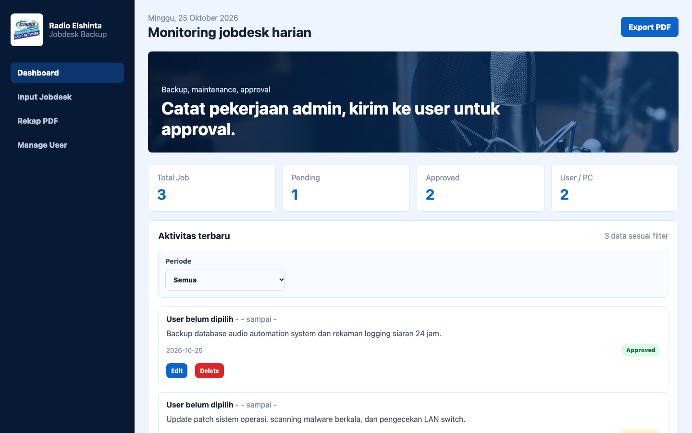
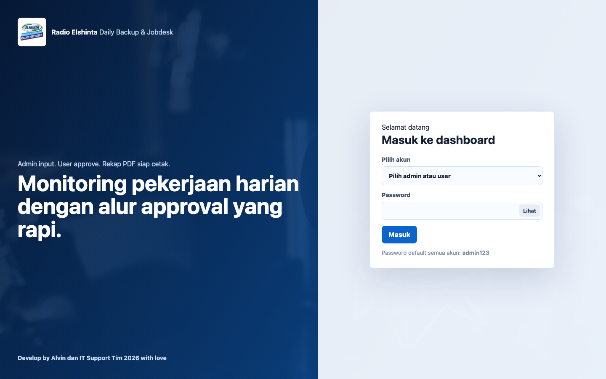
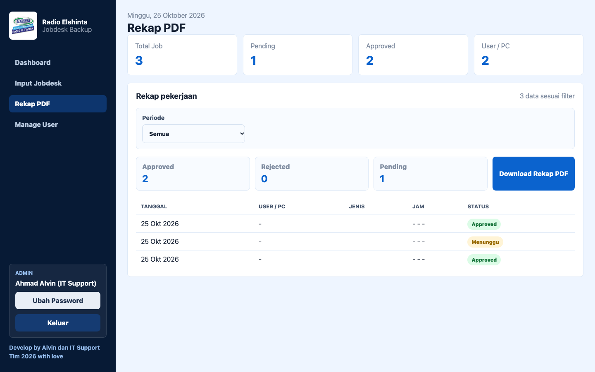
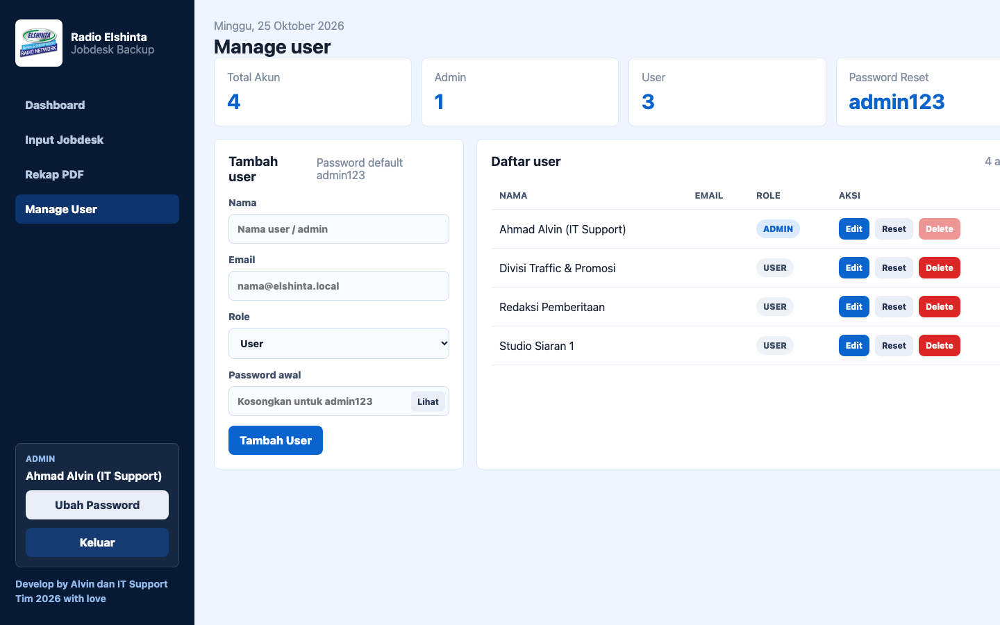

# 📻 Radio Elshinta Jobdesk & Daily Backup System
### Internal IT Operations • Laravel 11 • PHP 8.2 • Vite • Vanilla JS • MySQL • DomPDF

Sistem informasi operasional internal untuk mencatat, memantau, dan merekap pekerjaan harian tim **IT Support Radio Elshinta**, terutama backup rutin database automation, pengecekan komputer divisi siaran, alur persetujuan pengguna (*User Approval Workflow*), serta cetak rekap operasional otomatis ke PDF berstandar resmi.

---

## 📸 Preview & Screenshots

### 📊 Monitoring Jobdesk Harian (Admin Dashboard)
<p align="center">
  
</p>

---

### 🔐 Login & Autentikasi Pengguna
<p align="center">
  
</p>

---

### 📄 Rekap Laporan & Export PDF
<p align="center">
  
</p>

---

### 👥 Manajemen User & Komputer Inventaris
<p align="center">
  
</p>

---

## 🔄 Alur Kerja Sistem (Workflow)

```
[ Admin / IT Support ] ───> Input Pekerjaan Harian (Backup, Maintenance, Troubleshooting)
                                        │
                                        ▼
[ User / Divisi Terkait ] ───> Notifikasi & Review Pekerjaan di Dashboard
                                        │
                         ┌──────────────┴──────────────┐
                         ▼                             ▼
                 [ Setujui (Approve) ]        [ Tolak (Reject) ]
                         │                             │
                         └──────────────┬──────────────┘
                                        ▼
[ Admin / IT Supervisor ] ───> Filter Periode (Harian/Mingguan/Bulanan) ───> Export PDF Resmi
```

---

## ✨ Fitur Utama

- **🛡️ Multi-Role System**:
  - **Admin (IT Support)**: Input pekerjaan, edit & delete tiket pekerjaan, mengelola master user, mereset password, dan cetak laporan rekap.
  - **User (Studio / Redaksi / Traffic)**: Menerima laporan pekerjaan terkait komputer/divisi mereka, melakukan *Approval* atau *Reject* dengan catatan.
- **🖥️ Integrasi Inventaris Komputer**: Relasi otomatis antara user dan nama PC/IP Address (misal PC-STUDIO-01, PC-REDAKSI-02).
- **🖨️ Export PDF Resmi**: Pembuatan file PDF rekap pekerjaan lengkap dengan kop surat dan logo Radio Elshinta yang siap dicetak dan ditandatangani.
- **📅 Filter Fleksibel**: Filter rekap pekerjaan berdasarkan Semua Data, Harian, Mingguan, dan Bulanan.
- **🔒 Keamanan Akun**: Fitur ubah kata sandi mandiri dan reset password ke default `admin123` oleh admin.

---

## 🛠️ Tech Stack & Bahasa Pemrograman

| Layer | Teknologi | Peran & Deskripsi |
| :--- | :--- | :--- |
| **Backend Framework** | `PHP 8.2+`, `Laravel 11` | REST API, Business Logic, Routing, Eloquent ORM, dan Session Auth |
| **Frontend Runtime** | `JavaScript (ES Modules)`, `Vite` | SPA ringan, reactive UI state management tanpa bloatware framework |
| **Styling & Theme** | `Modern CSS3` | Desain responsif bertema biru resmi Radio Elshinta |
| **Database** | `MySQL / MariaDB` | Penyimpanan relasional terstruktur (Users, Daily Jobs, Assets) |
| **PDF Engine** | `Barryvdh Laravel DomPDF` | Rendering HTML template ke PDF berkualitas tinggi |
| **Role Authorization**| `Spatie Laravel Permission` | Pengaturan wewenang role `admin` dan `user` |

---

## 📁 Struktur Direktori

```text
elshinta-jobdesk/
├── backend/                  # Laravel 11 Application
│   ├── app/
│   │   ├── Http/Controllers/ # User, DailyJob, Asset, Auth Controllers
│   │   └── Models/          # Eloquent Models (User, DailyJob, Asset)
│   ├── database/
│   │   ├── migrations/      # DDL skema database
│   │   └── seeders/         # Data master awal & akun demo
│   ├── resources/views/     # Template Blade untuk cetak PDF
│   ├── routes/api.php       # Endpoint REST API
│   └── .env.example
├── frontend/                 # Vite Frontend SPA
│   ├── src/
│   │   ├── main.js          # Logic SPA, routing, state, dan event handlers
│   │   └── styles.css       # Token styling & theme Radio Elshinta
│   ├── public/              # Aset statis & logo Elshinta
│   ├── index.html           # HTML container
│   ├── package.json
│   └── vite.config.js
├── screenshots/             # Dokumentasi screenshot sistem
├── elshinta_jobdesk.sql     # Dump SQL database cadangan
├── package.json             # Root runner scripts
└── README.md
```

---

## ⚙️ Prasyarat Sistem

Sebelum menjalankan aplikasi, pastikan komputer Anda telah terinstal:
- **PHP**: Versi `8.2` atau lebih baru (ekstensi: `pdo_mysql`, `mbstring`, `openssl`, `gd`)
- **Composer**: Versi `2.x`
- **Node.js**: Versi `18.x` atau `20.x` LTS
- **MySQL / MariaDB**: Server database lokal aktif (XAMPP atau Homebrew)

---

## 🚀 Panduan Instalasi & Menjalankan Lokal

### 1. Clone Repositori
```bash
git clone https://github.com/ahmadalvin92/radio-elshinta-jobdesk.git
cd radio-elshinta-jobdesk
```

### 2. Setup Database
1. Buat database baru di MySQL dengan nama `elshinta_jobdesk`:
   ```sql
   CREATE DATABASE elshinta_jobdesk;
   ```
2. Anda dapat mengimpor file `elshinta_jobdesk.sql` ke database tersebut, atau menjalankan migrasi Laravel pada langkah berikutnya.

### 3. Setup Backend (Laravel)
1. Masuk ke folder `backend`:
   ```bash
   cd backend
   composer install
   ```
2. Buat file `.env`:
   ```bash
   cp .env.example .env
   php artisan key:generate
   ```
3. Sesuaikan konfigurasi database pada `.env`:
   ```env
   DB_CONNECTION=mysql
   DB_HOST=127.0.0.1
   DB_PORT=3306
   DB_DATABASE=elshinta_jobdesk
   DB_USERNAME=root
   DB_PASSWORD=
   ```
4. Jalankan migrasi dan seeder:
   ```bash
   php artisan migrate --seed
   ```
5. Jalankan server Laravel:
   ```bash
   php artisan serve --port=8000
   ```
   *Backend aktif di `http://127.0.0.1:8000`.*

### 4. Setup Frontend (Vite)
1. Buka jendela terminal baru dan masuk ke folder `frontend`:
   ```bash
   cd frontend
   npm install
   ```
2. Buat file `.env` (opsional bila backend berjalan di port 8000):
   ```env
   VITE_API_BASE_URL="http://127.0.0.1:8000"
   ```
3. Jalankan server pengembangan Vite:
   ```bash
   npm run dev
   ```
4. Buka browser di [http://localhost:5173](http://localhost:5173) atau port yang ditampilkan oleh Vite.

---

## 🔑 Kredensial Default Akun

Semua akun default memiliki kata sandi awal: `admin123`

| Akun | Peran | Deskripsi |
| :--- | :--- | :--- |
| **Alvin** | `Admin` | IT Support Administrator |
| **Studio 1** | `User` | Komputer siaran utama |
| **Redaksi** | `User` | Komputer jurnalis pemberitaan |

---

## 👨‍💻 Author & Credits

**Ahmad Alvin Griffin** & **Tim IT Support Radio Elshinta 2026 with love**  
- GitHub: [@ahmadalvin92](https://github.com/ahmadalvin92)
- Lokasi: Jakarta, Indonesia
